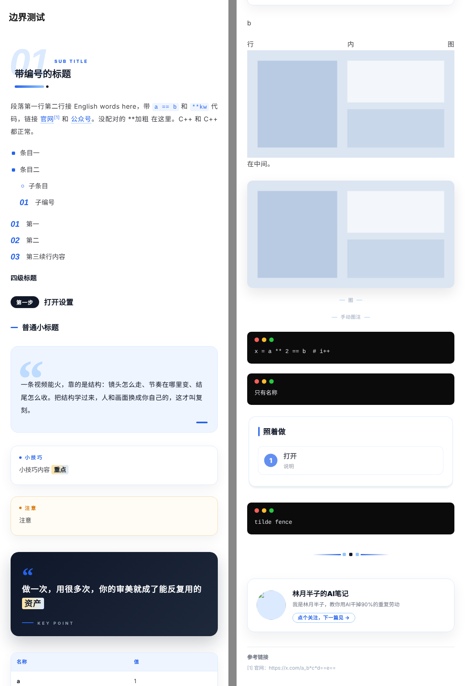
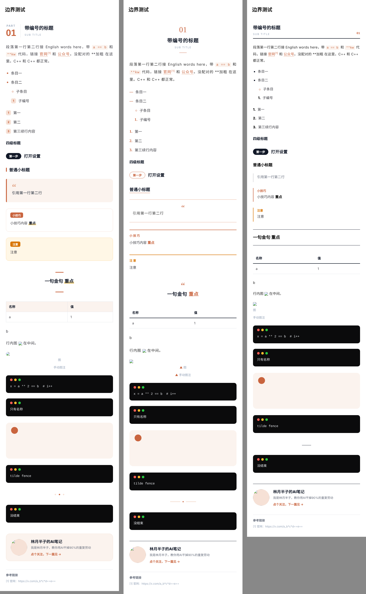
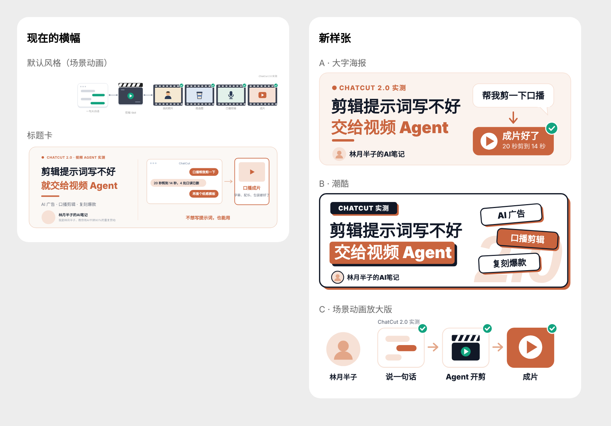
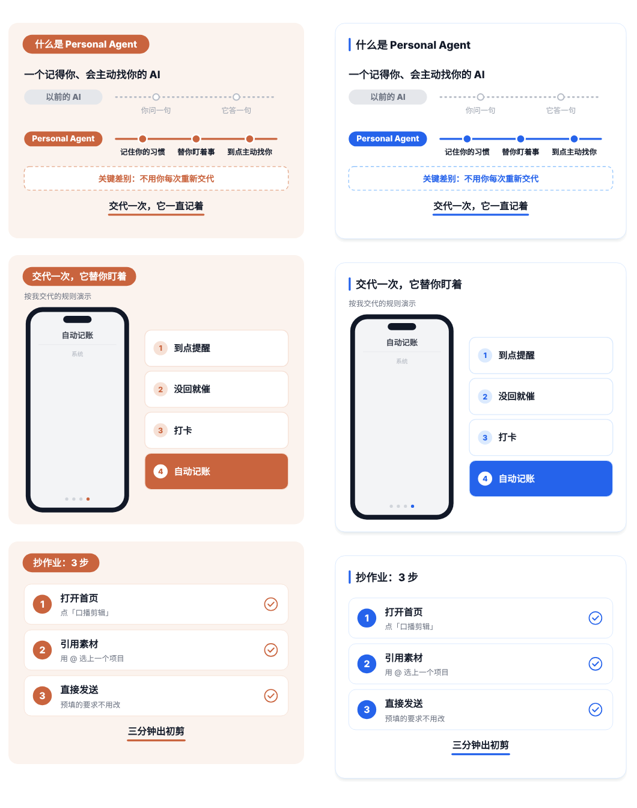

# wechat-article-skills

> 把 Markdown 一键排成能直接粘贴进微信公众号的版式：开头带动画横幅，正文里的表格、步骤能变成会动的 SVG 卡片。
>
> Agent skills that turn a Markdown article into WeChat Official Account–ready HTML, with an animated SVG banner and animated SVG cards.

三个 skill，给 Claude Code、WorkBuddy 这类支持 Skill 的 agent 用。你只管写 Markdown，排版交给 agent：

| Skill | 做什么 |
|---|---|
| [`wechat-article-layout`](skills/wechat-article-layout) | **主 skill**。Markdown → 公众号排版页，6 种风格 × 9 种配色，内置 8 种动画卡，开头自动配横幅 |
| [`wechat-opening-banner`](skills/wechat-opening-banner) | 单独做文章开头的动画横幅，4 种风格 |
| [`wechat-svg-cards`](skills/wechat-svg-cards) | 文章已经排好、只想补一两张动画卡时用 |

写完一篇公众号，跟 agent 说一句「帮我排版」，拿到一个 HTML 页面：用 Chrome 打开，顶部选风格和配色，点「复制全文到公众号」，去编辑器里粘贴，完事。



---

## 它能排出什么

### 6 种风格 × 9 种配色

风格管结构，标题、重点、引用卡、列表、表格、分隔线都不一样；配色只管颜色。两者在排版页顶部自由组合，一共 54 种。

| 风格 | 写法 | 特点 |
|---|---|---|
| 标准 | `std` | PART 01 大标题、荧光笔加粗、圆角卡片 |
| 杂志 | `mag` | 宋体标题居中、细线、留白多 |
| 极简 | `min` | 黑白为主、无底色、左对齐 |
| 极客 | `geek` | 等宽字 `// PART_01`、虚线框、终端感 |
| 醒目 | `bold` | 大色块标题、粗圆角、强对比 |
| 质感 | `neo` | 巨型编号和大引号做底纹、细线、柔和阴影 |

配色：品牌橙、科技蓝、薄荷绿、墨黑、藏青金、葡萄紫、胭脂红、琥珀、莫兰迪。



### 4 种开头横幅

| 风格 | 写法 | 适合 |
|---|---|---|
| 大字海报 | `poster` | 想让读者在手机上一眼看清标题。字最大，推荐 |
| 质感 | `neo` | 和质感正文成套；正文切到质感风格时，海报横幅会自动换成这个 |
| 标题卡 | `card` | 左边标题、右边 12 种版式，信息多 |
| 默认 | 不写 `style` | 作者头像 GIF + 像素口号 + 10 种场景动画（见下方「换成你自己的」） |


> 为什么推荐大字海报：横幅画布宽 1246，在手机上会缩到大约 0.28 倍。标题卡和默认风格里那些小标签，到了手机上只剩三四个像素。大字海报的最小字号是按手机可读定的。
>
> 

### 8 种动画 SVG 卡

在 Markdown 里写一个 `svg-xxx` 代码块，排版时变成会动的卡片，配色跟着当前风格走，10 秒一轮循环播放。

| 写法 | 画面 |
|---|---|
| `svg-table` | 表格一行行滑入，`★` 行高亮 |
| `svg-bars` | 横向柱子依次长出 |
| `svg-steps` | 步骤卡依次滑入，打勾 |
| `svg-timeline` | 时间线画过去，节点点亮 |
| `svg-breakdown` | 长指令拆解，荧光笔逐行扫过 |
| `svg-compare` | 以前 vs 现在，左灰 × 右 ✓ |
| `svg-concept` | 新旧两条线对比，一眼看懂一个概念 |
| `svg-phone` | 手机里一幕幕轮播的演示（示意，不是截图） |



---

## 快速开始

### 1. 安装

**Claude Code**：把 `skills/` 下的三个文件夹复制到 `~/.claude/skills/`。

```bash
git clone https://github.com/<你的用户名>/wechat-article-skills.git
cp -r wechat-article-skills/skills/* ~/.claude/skills/
```

**WorkBuddy 等支持上传 zip 的 agent**：到 [Releases](../../releases) 下载三个 zip，分别导入。也可以自己打包：

```bash
cd skills && for s in */; do zip -qr "${s%/}.zip" "$s"; done
```

只需要 Python 3，脚本只用标准库，不用装依赖。

### 2. 用

把文章交给 agent，说「帮我排成公众号版式」。它会先问你横幅用哪种风格，然后：

1. 给文章补必要的标记（不改写内容）
2. 跑 `scripts/layout.py`，打印一份自查报告
3. 交给你一个 `xxx-公众号排版.html`

也可以自己跑：

```bash
cd skills/wechat-article-layout/scripts
python3 layout.py 文章.md --banner banner.json --style neo --theme blue --out out
```

### 3. 复制到公众号

1. 用 **Chrome 直接打开** HTML 文件（聊天窗口里的预览写不了剪贴板）
2. 顶部选风格、配色，填头像 GIF 地址
3. 点「复制全文到公众号」，到公众号编辑器正文里粘贴
4. 发预览到手机确认

---

## Markdown 写法速查

大部分是标准 Markdown，加了几个小扩展。完整写法见 [`wechat-article-layout/SKILL.md`](skills/wechat-article-layout/SKILL.md)。

| 你写 | 排出来 |
|---|---|
| `## 标题 \| ENGLISH SUB` | PART 01 大标题 + 英文小字。原文自带的「一、」会自动去掉 |
| `### 第一步：xxx` | 步骤标签 + 小标题 |
| `**重点**` | 荧光笔加粗 |
| `==一句话==` | 主题色色块 |
| `++一句话++` | 主题色下划线 |
| `> 引用` | 引用卡 |
| `> [!QUOTE] 金句` | 金句卡 |
| `> [!TIP]` / `[!NOTE]` / `[!WARN]` / `[!TLDR]` | 提示卡 |
| ` ```bash ` | 黑底 terminal |
| ` ```prompt 文件名 ` | 长提示词滑动卡（PROMPT 标签） |
| ` ```promptbox 标题 ` | 长提示词虚线滑动卡 |
| `` | 长图滑动卡 |
| 图片下面一行短句（结尾没标点） | 自动排成图注 |
| `^ 一行说明` | 手动图注 |
| 单独一行 `[xxx.mp4]` | 「此处放视频」占位框 |
| ` ```svg-xxx 标题 ` | 动画卡（见上表） |

飞书导出的 Markdown 可以直接用：转义反斜杠会自动清掉，列表之间的空行不会把编号打断。

### 自查报告

每次排版完，脚本会打印类似这样的报告，告诉你发布前还要处理什么：

```
统计：图片 22，图注 9，视频占位 8，动画卡 1，滑动卡 2
发布前要处理：
  - 22 张图是飞书临时链接，粘进公众号会丢，发布前换成公众号图库地址
  - 8 处视频占位，需要在公众号里手动插视频或删掉
```

---

## 换成你自己的

这套 skill 是我给自己的公众号「林月半子的AI笔记」做的，默认值都是我的。拿去用之前改这几处：

- **作者卡文案**：在文章开头的 front matter 里写

  ```yaml
  ---
  author: 你的公众号名
  slogan: 你的一句话介绍
  outro_cta: 点个关注，下一篇见 →
  ---
  ```

  不想要文末作者卡，写 `outro: false`。

- **横幅署名**：大字海报、质感、标题卡的 spec 里写 `"author": "你的公众号名"`。标题卡还可以写 `"slogan"`。
- **头像 GIF**：排版页顶部填你自己的头像地址。必须是公众号图库里的图（`https://mmbiz.qpic.cn/` 开头），本地图片和 base64 粘进公众号会丢。
- **默认风格横幅的像素口号**：这一行是点阵字，写死在 `banner.py` 的 `SLOGAN` 里，改起来比较麻烦。建议直接用大字海报或质感横幅，它们没有口号。
- **SKILL.md 里的「林月半子」**：skill 描述里写的是给我的文章用，换成你自己的名字，agent 触发起来更准。

---

## 公众号的硬限制

脚本已经按这些规则生成，改代码时别破坏：

- 所有样式写成行内 `style`，不用 `<style>` 标签和 class
- SVG 里不能有 `id`、`class`、`<style>`、`<script>`、滤镜、`<use>`、clipPath
- SVG 动画只能用 SMIL（`<animate>`、`<animateTransform>`、`<set>`），不能用 CSS 动画
- 图片只认 `mmbiz.qpic.cn` 的地址
- 文中不能放外链：普通链接会自动转成文末脚注

## 已知限制

- 渐变、flex 布局、可滑动区域、阴影，我主要在浏览器里验证过，公众号编辑器偶尔会改写样式。**发布前请务必发预览到手机看一遍。**
- 质感风格的阴影：SVG 里不支持模糊滤镜，是用三层低透明度色块叠出来的。
- 杂志风格的宋体标题，在没有宋体的安卓机上会显示成黑体。
- 动画卡是示意图，不能代替真实截图。尤其是商单文章，截图能证明的地方用截图。

---

## 目录结构

```
skills/
├── wechat-article-layout/     主 skill
│   ├── SKILL.md
│   ├── scripts/layout.py       排版脚本（含 8 种动画卡）
│   ├── scripts/banner.py       横幅脚本（副本）
│   └── examples/               示例文章和横幅 spec
├── wechat-opening-banner/
│   ├── SKILL.md
│   ├── scripts/banner.py
│   └── examples/               30+ 个横幅 spec
└── wechat-svg-cards/
    ├── SKILL.md
    ├── scripts/layout.py       和主 skill 同一份脚本（副本）
    └── examples/cards.md
docs/images/                    README 配图
```

`layout.py` 和 `banner.py` 各有一份副本，这样每个 skill 单独安装也能用。改脚本时记得同步。

## 关于

作者：林月半子，公众号「林月半子的AI笔记」。这套 skill 是和 Claude 一起做的，前后用 Opus 5.5 和 Fable 5.2 迭代了好几轮。

欢迎提 Issue 和 PR，尤其是在公众号里实际粘贴后发现样式被吞掉的情况，附上截图就行。

## License

MIT
